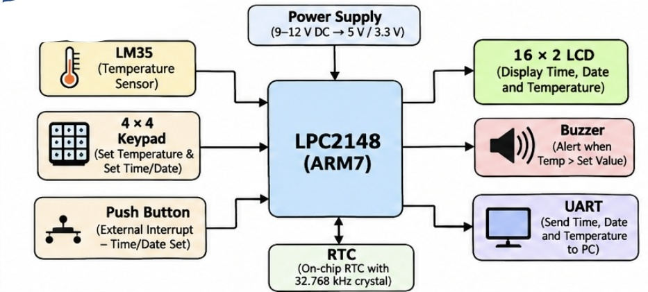
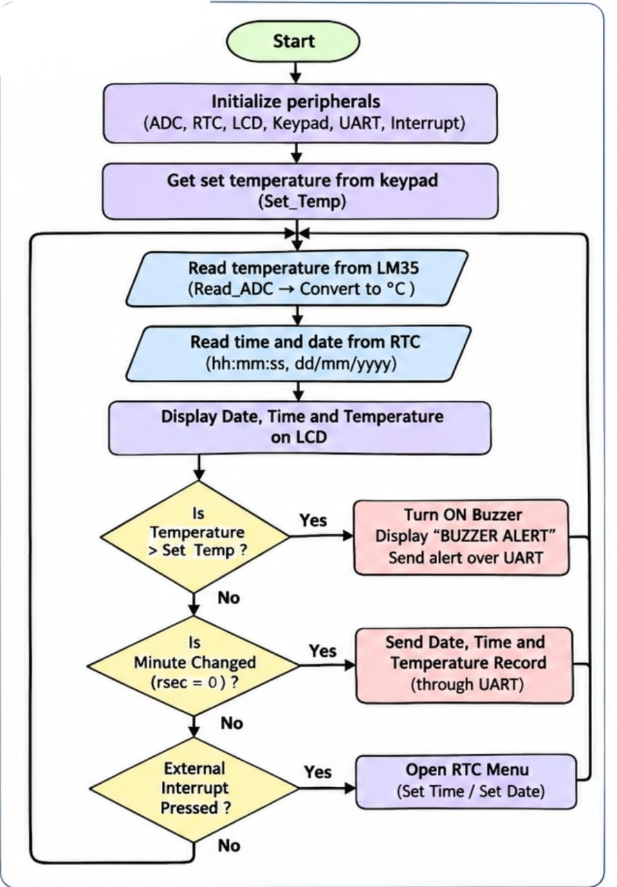
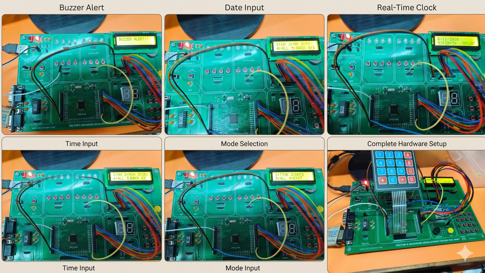

# 🏭 Industrial Environment Monitoring & Real-Time Data Logger (ARM7 LPC2148)

-blue)


A bare-metal embedded firmware system built on the **NXP LPC2148 (ARM7)** microcontroller for continuous industrial temperature monitoring, threshold-based audio alarming, real-time LCD telemetry, and automated serial data logging.

---

## 🔌 System Block Diagram



---

## 🔄 Firmware Execution Flowchart



---

## 📸 Hardware Showcase

<p align="center">
  
</p>

- **Buzzer Alert:** Activates audio alarm and displays `BUZZER ALERT!!` on the 16×2 LCD when ambient temperature exceeds the configured setpoint.
- **Date Input:** Interactive keypad sub-menu (`1:DD 2:MM 3:YY 4:ALL 5:BACK 6:E`) for configuring individual or complete RTC date fields.
- **Real-Time Clock:** Displays live RTC date, timestamp, and LM35 temperature reading (`6/11/2026 03:28:50 TM:28°`) during active monitoring.
- **Time Input:** Interactive keypad sub-menu (`1:HH 2:MIN 3:SEC 4:ALL 5:BACK 6:E`) for setting hours, minutes, and seconds.
- **Mode Selection:** Main interrupt-triggered RTC configuration menu (`1:TIME 2:DATE 3:ALL 4:EXIT`).
- **Complete Hardware Setup:** Vector's ARM7 (LPC2148) development board wired to the 16×2 LCD, 4×4 matrix keypad, LM35 temperature sensor, buzzer, and DB9 UART0 serial interface.

---

## ✨ Key Features
- **Precision Analog Sensing:** Interfaces with an **LM35** temperature sensor via the on-chip 10-bit ADC (`3 MHz` ADC clock) with real-time Celsius conversion (`10 mV/°C`).
- **Interactive Threshold Configuration:** Uses a **4×4 Matrix Keypad** and **16×2 Alphanumeric LCD** with backspace (`*`) and confirmation (`#`) handling to set custom temperature limits at boot.
- **Interrupt-Driven RTC Updates:** Uses **External Interrupt 1 (EINT1)** on `P0.3` to pause normal monitoring and allow live reconfiguration of Date and Time (`HH:MM:SS` & `DD/MM/YYYY`) via an interactive LCD menu.
- **Automated UART0 Telemetry:** Logs formatted timestamped temperature reports to a PC serial terminal (`9600 bps, 8N1`) once every minute and triggers instant `[!!] TEMPERATURE ALERT` banners during threshold breaches.
- **Audio Alarm System:** Activates an industrial buzzer on `P0.19` whenever ambient temperature exceeds the configured setpoint.

---

## 📌 Hardware Pinout & Peripheral Mapping

| Peripheral | LPC2148 Pin(s) | Function / Description |
| :--- | :--- | :--- |
| **LM35 Temp Sensor** | `P0.29` (`AIN2`) | Analog voltage input (`10 mV/°C`) |
| **16×2 LCD Data Bus** | `P0.8 – P0.15` | 8-bit parallel data interface (`D0–D7`) |
| **16×2 LCD Control** | `P0.16`, `P0.18`, `P0.17` | `RS`, `RW`, and `EN` control lines |
| **4×4 Keypad Rows** | `P1.16 – P1.19` | Row scan outputs (`ROW0–ROW3`) |
| **4×4 Keypad Columns** | `P1.20 – P1.23` | Column sense inputs (`COL0–COL3`) |
| **UART0 Serial** | `P0.0` (`TXD0`), `P0.1` (`RXD0`) | Serial data logger (`9600 baud`) |
| **External Interrupt** | `P0.3` (`EINT1`) | Edge-triggered interrupt for RTC setup |
| **Alert Buzzer** | `P0.19` | Digital GPIO output (`HIGH` = Alert) |

---

## 🖥️ Sample UART Serial Output
📄 Full captured log available in [`uart_log.txt`](uart_log.txt)

```text
============================================================
       INDUSTRIAL ENVIRONMENT MONITORING SYSTEM
          ARM7 LPC2148 | REAL-TIME DATA LOGGER
============================================================

 SYSTEM CONFIGURATION
 ------------------------------------------------------------
 Temperature Setpoint : 35.0 ° C
 Monitoring Status    : ACTIVE
 ------------------------------------------------------------

 [!!] TEMPERATURE ALERT
 ------------------------------------------------------------
 Alert Temperature : 52.5 ° C
 BUZZER STATUS : ACTIVATED
 ------------------------------------------------------------

 REAL-TIME SENSOR DATA
 ------------------------------------------------------------
 DATE         TIME          TEMPERATURE
 ------------------------------------------------------------
 10/11/2026    03:55:00       30.9 ° C
============================================================

Time: 03:55:08 | INTERUPPT RAISED....
Time : 03:55:20 | RTC UPDATED
============================================================
SYSTEM STATUS : MONITORING ACTIVE 
============================================================

 REAL-TIME SENSOR DATA
 ------------------------------------------------------------
 DATE         TIME          TEMPERATURE
 ------------------------------------------------------------
 10/11/2026    03:56:00       27.7 ° C
