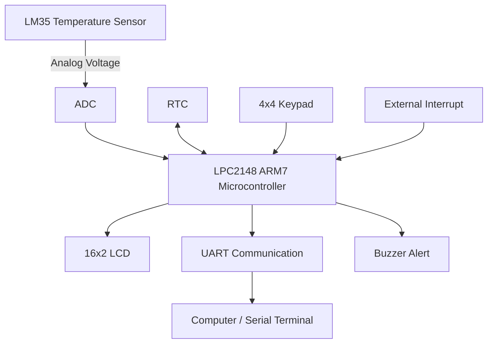
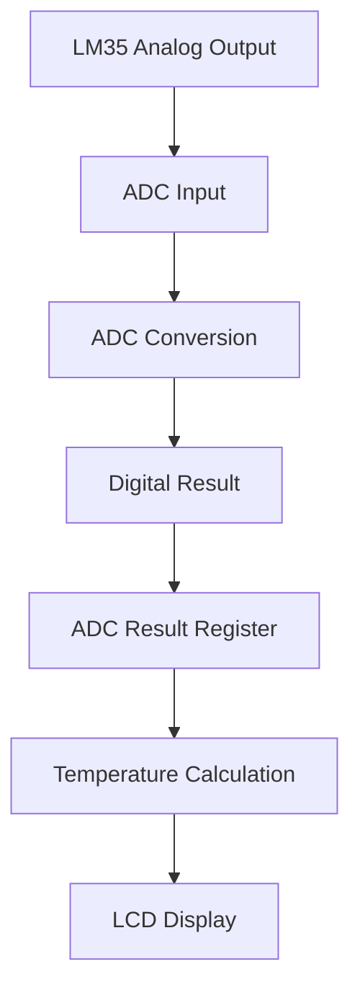
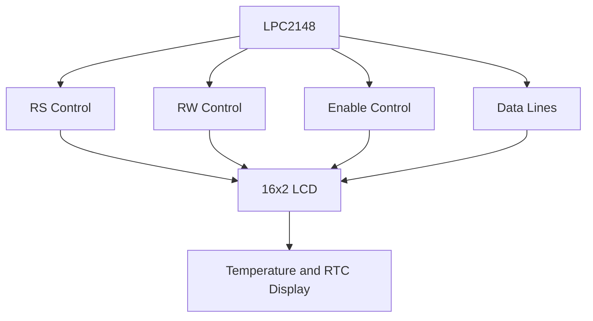
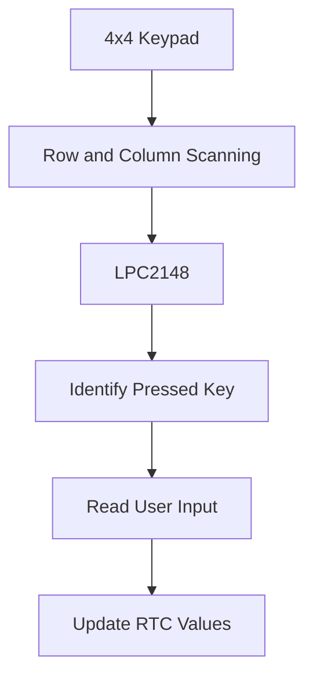
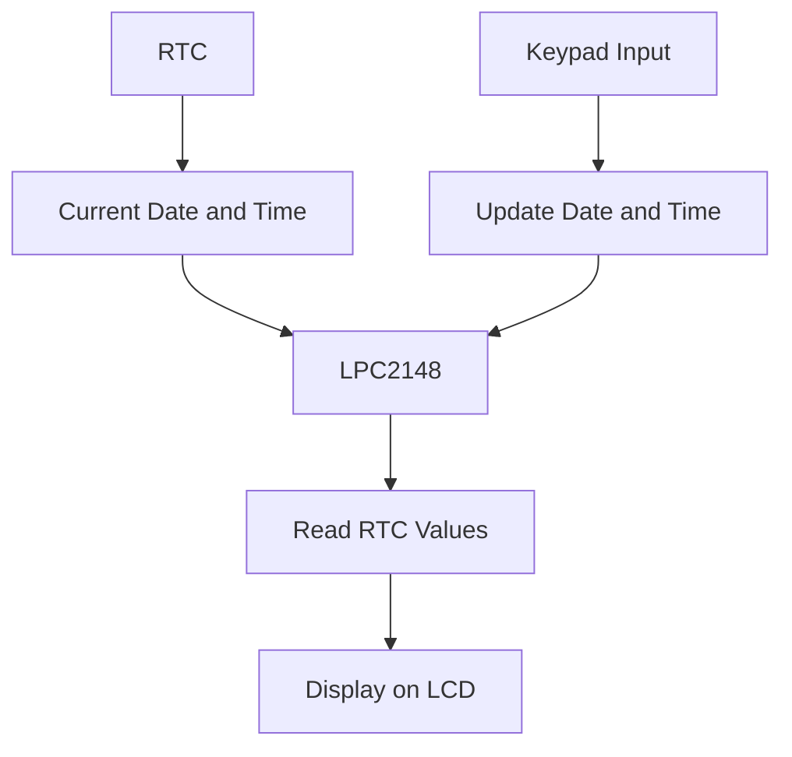
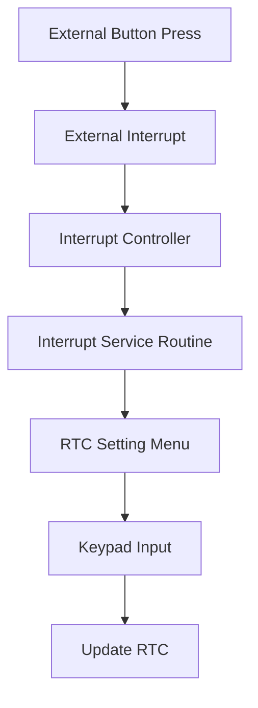
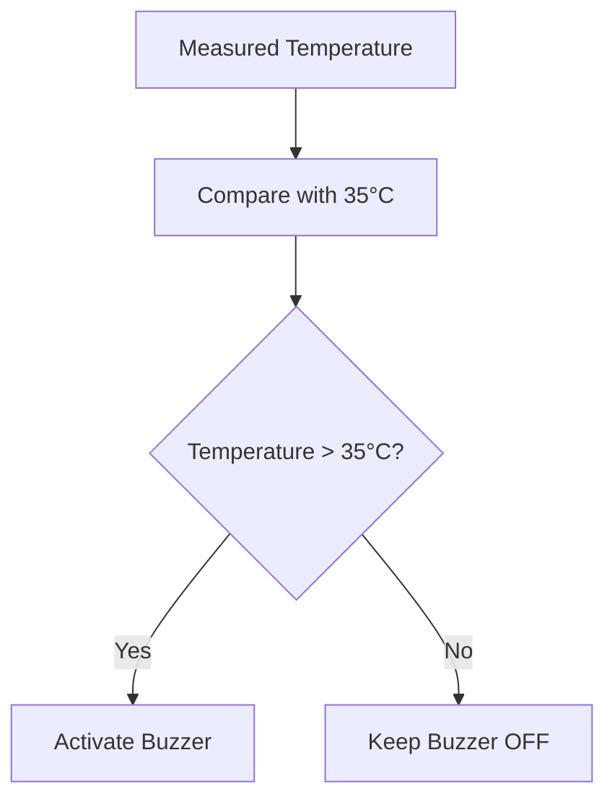
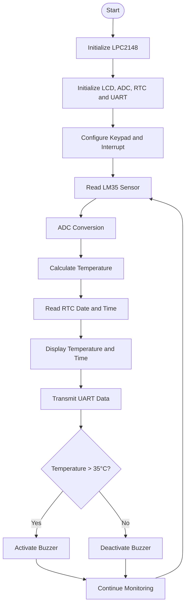

# Industrial Environment Monitoring System Using LPC2148


## 1. Project Overview

The **Industrial Environment Monitoring System** is an embedded systems project developed using the LPC2148 ARM7 microcontroller.

The main objective of this project is to continuously monitor the surrounding temperature and display the temperature along with real-time clock information.

The system uses an LM35 temperature sensor to measure the surrounding temperature. The analog output generated by the sensor is converted into a digital value using the inbuilt ADC of the LPC2148.

The measured temperature and RTC date and time are displayed on a 16x2 LCD. A keypad is provided to modify the RTC date and time. An external interrupt is used to enter the RTC setting menu.

When the measured temperature exceeds the predefined threshold of **35°C**, a buzzer is activated to generate an alert.

UART communication is also implemented to transmit monitoring information to a computer through a serial terminal.

## 2. Project Objectives

- Monitor environmental temperature continuously.
- Measure temperature using the LM35 sensor.
- Convert analog sensor output into digital data using ADC.
- Display temperature and date/time on a 16x2 LCD.
- Maintain real-time date and time using RTC.
- Modify RTC values using a matrix keypad.
- Use an external interrupt to enter the RTC setting menu.
- Activate a buzzer when temperature exceeds 35°C.
- Transmit monitoring information through UART.
- Understand peripheral interfacing with the LPC2148 microcontroller.

## 3. Hardware Components

| Component | Purpose |
|---|---|
| LPC2148 ARM7 | Main microcontroller |
| LM35 | Temperature measurement |
| ADC | Analog-to-digital conversion |
| 16x2 LCD | Display temperature and time |
| RTC | Maintain date and time |
| 4x4 Matrix Keypad | User input |
| Buzzer | Temperature alert |
| UART | Serial communication |
| MAX232 | RS232 voltage-level conversion, if used |

## 4. Software Requirements

- Keil µVision
- Embedded C
- LPC2148 ARM7 microcontroller
- Proteus (if used for simulation)
- Serial terminal for UART monitoring

## 5. System Architecture

The following block diagram represents the overall architecture of the project.



## 6. Peripheral Interfacing and Working

### 6.1 LPC2148 ARM7 Microcontroller

The LPC2148 is an ARM7TDMI-S-based microcontroller. It acts as the central processing unit of this project.

It receives sensor data, processes the information and controls the connected peripherals.

**Main responsibilities:**

- Read temperature data from the LM35 sensor through ADC.
- Process the ADC result.
- Read RTC date and time.
- Display information on the LCD.
- Read keypad inputs.
- Handle external interrupts.
- Transmit data through UART.
- Control the buzzer.

**LPC2148 development board reference:**


[View LPC2148 technical information](https://www.nxp.com/products/LPC2148)

### 6.2 LM35 Temperature Sensor

The LM35 is an analog temperature sensor used to measure the surrounding temperature.

It produces an output voltage proportional to the measured temperature.

**Important characteristics:**

- Analog output.
- Output scale factor: 10 mV/°C.
- Temperature measurement using voltage variation.
- Can be interfaced with the LPC2148 ADC.

**Example output values:**

| Temperature | LM35 Output Voltage |
|---|---:|
| 25°C | 250 mV |
| 30°C | 300 mV |
| 35°C | 350 mV |
| 40°C | 400 mV |

**LM35 sensor reference image:**


**LM35 interfacing block diagram:**


The LM35 output is connected to the ADC input of the LPC2148.

### 6.3 ADC Interfacing

ADC stands for **Analog-to-Digital Converter**.

The LM35 produces an analog voltage, whereas the microcontroller processes digital values. Therefore, ADC is used to convert the analog voltage into a digital value.

The LPC2148 contains an inbuilt 10-bit ADC.

A 10-bit ADC produces digital values from 0 to 1023.

**ADC working block diagram:**



**ADC connection:**

| Signal | LPC2148 Pin |
|---|---|
| LM35 Output | P0.29 / AD0.2 |

The ADC result is processed by the microcontroller to obtain the corresponding temperature value.

### 6.4 16x2 LCD Interfacing

A 16x2 character LCD is used to display the measured temperature and RTC information.

It contains 2 rows and 16 columns.

The microcontroller sends commands and data to the LCD through its control and data pins.

**LCD reference image:**


**Important LCD pins:**

| LCD Pin | Function |
|---|---|
| RS | Register Select |
| RW | Read/Write |
| EN | Enable |
| D0-D7 | Data Lines |

**LCD interfacing block diagram:**



**LCD pin connections:**

| LCD Signal | LPC2148 Pin |
|---|---|
| D0-D7 | P0.8-P0.15 |
| RS | P0.16 |
| EN | P0.17 |
| RW | P0.18 |

### 6.5 4x4 Matrix Keypad Interfacing

A 4x4 matrix keypad is used to enter date and time values.

It consists of:

- 4 rows.
- 4 columns.
- 16 keys.

The microcontroller scans the rows and columns to identify the pressed key.

In this project, the keypad is used to enter individual RTC fields. The `#` key is used to confirm the entered value.

**Keypad reference:**


**Keypad working block diagram:**



**Keypad pin connections:**

| Keypad Signal | LPC2148 Pin |
|---|---|
| Row 1 | P1.16 |
| Row 2 | P1.17 |
| Row 3 | P1.18 |
| Row 4 | P1.19 |
| Column 1 | P1.20 |
| Column 2 | P1.21 |
| Column 3 | P1.22 |
| Column 4 | P1.23 |

### 6.6 RTC Interfacing

RTC stands for **Real-Time Clock**.

It is used to maintain the current date and time.

The RTC provides:

- Seconds
- Minutes
- Hours
- Date
- Month
- Year
- Day of the week

The LPC2148 reads the RTC values and displays them on the LCD.

The RTC date and time can also be modified using the keypad.

**RTC module reference image:**


**RTC working block diagram:**



**Working:**

1. RTC maintains the current time and date.
2. LPC2148 reads the RTC registers.
3. The received values are processed.
4. The date and time are displayed on the LCD.
5. The user can enter new values through the keypad.
6. The microcontroller updates the RTC.

### 6.7 External Interrupt

An external interrupt allows the microcontroller to respond immediately to an external event.

In this project, an external interrupt is used to enter the RTC date and time setting menu.

**Working:**

1. An external button generates an interrupt.
2. The interrupt controller detects the interrupt.
3. The interrupt service routine is executed.
4. The RTC setting menu is entered.
5. The user enters date and time values using the keypad.
6. The updated values are stored in the RTC.

**External interrupt block diagram:**



**Note:** Verify the exact EINT pin and edge configuration against your final source code and hardware connections.

### 6.8 UART Communication

UART stands for **Universal Asynchronous Receiver Transmitter**.

UART is used for serial communication between the LPC2148 and an external computer or serial terminal.

In this project, UART transmits temperature and RTC information.

**Important UART signals:**

| Signal | Function |
|---|---|
| TXD | Transmit Data |
| RXD | Receive Data |
| GND | Common Ground |

**UART reference:**


**UART working block diagram:**


**UART pin connections:**

| UART Signal | LPC2148 Pin |
|---|---|
| TXD0 | P0.0 |
| RXD0 | P0.1 |

If an RS232 interface is used, a MAX232 IC is required to convert the voltage levels between the microcontroller UART and RS232 equipment.

### 6.9 Buzzer Interfacing

A buzzer is used to generate an audible alert when the measured temperature exceeds the predefined threshold.

The threshold temperature in this project is:

`SET_TEMP = 35`

**Working:**

- The microcontroller continuously reads the temperature.
- The measured temperature is compared with 35°C.
- If the temperature exceeds 35°C, the buzzer is activated.
- Otherwise, the buzzer remains OFF.

**Buzzer working block diagram:**



**Hardware note:** If the buzzer requires more current than a GPIO pin can safely provide, use a suitable transistor driver. Verify the buzzer's operating voltage and current requirements.

## 7. Pin Configuration Summary

The following table summarizes the pin assignments used in the project. Verify them against the final source code and actual hardware wiring.

| Peripheral | Signal | LPC2148 Pin |
|---|---|---|
| LM35 | Analog Output | P0.29 / AD0.2 |
| LCD | Data D0-D7 | P0.8-P0.15 |
| LCD | RS | P0.16 |
| LCD | EN | P0.17 |
| LCD | RW | P0.18 |
| Keypad | Rows | P1.16-P1.19 |
| Keypad | Columns | P1.20-P1.23 |
| UART0 | TXD0 | P0.0 |
| UART0 | RXD0 | P0.1 |
| Buzzer | GPIO | P0.19 |
| RTC | RTC peripheral | Internal RTC registers |
| External Interrupt | EINT | Verify from source code |

## 8. Overall Project Working

The complete system operates in the following sequence:

1. Initialize the LPC2148 microcontroller.
2. Initialize LCD, ADC, RTC and UART.
3. Configure keypad and external interrupt.
4. Read the analog output from the LM35 sensor.
5. Convert the analog value into a digital value using ADC.
6. Calculate the temperature.
7. Read the current RTC date and time.
8. Display temperature and time on the LCD.
9. Transmit monitoring information through UART.
10. Compare the temperature with the threshold value of 35°C.
11. Activate the buzzer if the temperature exceeds 35°C.
12. Continue monitoring continuously.

**Complete project flowchart:**



## 9. Expected Output

### LCD Display

The LCD displays the current temperature and RTC information.

Example:

```text
TEMP: 32 C
TIME: 14:25:30
```

### UART Output

Example serial output:

```text
Industrial Environment Monitoring System

Temperature : 32 C
Time        : 14:25:30
Date        : 21/11/2026

Temperature Status : NORMAL
```

When the temperature exceeds the threshold:

```text
Temperature : 38 C
Temperature Status : HIGH
ALERT: BUZZER ACTIVATED
```

*These are illustrative output examples, not screenshots of measured hardware results.*

## 10. Software Modules

The project is developed using Embedded C.

The software is organized into separate peripheral modules.

| Module | Description |
|---|---|
| main.c | Main application program |
| lm35.c / lm35.h | Temperature sensor interface |
| miniadc.c / miniadc.h | ADC configuration and conversion |
| minilcd.c / minilcd.h | LCD interfacing |
| minikpm.c / minikpm.h | Keypad interfacing |
| rtc.c / rtc.h | RTC operations |
| uart.c / uart.h | UART communication |
| interrupt.c / interrupt.h | External interrupt handling |

*Adjust the filenames according to the actual files in your repository.*

## 11. Testing

| Test | Expected Result |
|---|---|
| Power ON | System initializes |
| Temperature reading | LM35 temperature is displayed |
| ADC conversion | Analog value is converted |
| RTC operation | Date and time are displayed |
| Keypad operation | User input is detected |
| RTC setting | Date and time can be updated |
| Temperature below 35°C | Buzzer remains OFF |
| Temperature above 35°C | Buzzer is activated |
| UART operation | Monitoring data is transmitted |

## 12. Applications

- Industrial temperature monitoring.
- Equipment temperature supervision.
- Laboratory environment monitoring.
- Embedded monitoring systems.
- Temperature alert systems.

## 13. Future Enhancements

- Add humidity monitoring.
- Add an IoT-based monitoring system.
- Send alerts through Wi-Fi or GSM.
- Store temperature readings in EEPROM.
- Add data logging.
- Add multiple temperature sensors.
- Implement a graphical monitoring dashboard.

## 14. Conclusion

The Industrial Environment Monitoring System demonstrates the interfacing of multiple peripherals with the LPC2148 ARM7 microcontroller.

The project combines temperature sensing, ADC conversion, LCD display, RTC, keypad input, external interrupt handling, UART communication and buzzer alert generation.

This project provides practical knowledge of Embedded C programming, ARM7 microcontroller architecture, peripheral interfacing and real-time embedded systems.

## 15. Repository Structure

```text
Industrial-Environment-Monitoring/
│
├── README.md
│
├── main.c
├── lm35.c
├── lm35.h
├── miniadc.c
├── miniadc.h
├── minilcd.c
├── minilcd.h
├── minikpm.c
├── minikpm.h
├── rtc.c
├── rtc.h
├── uart.c
├── uart.h
├── interrupt.c
├── interrupt.h
│
└── docs/
    └── images/
```

## 16. Author

**Project:** Industrial Environment Monitoring System  
**Microcontroller:** LPC2148 ARM7  
**Programming Language:** Embedded C  
**Development Environment:** Keil µVision
